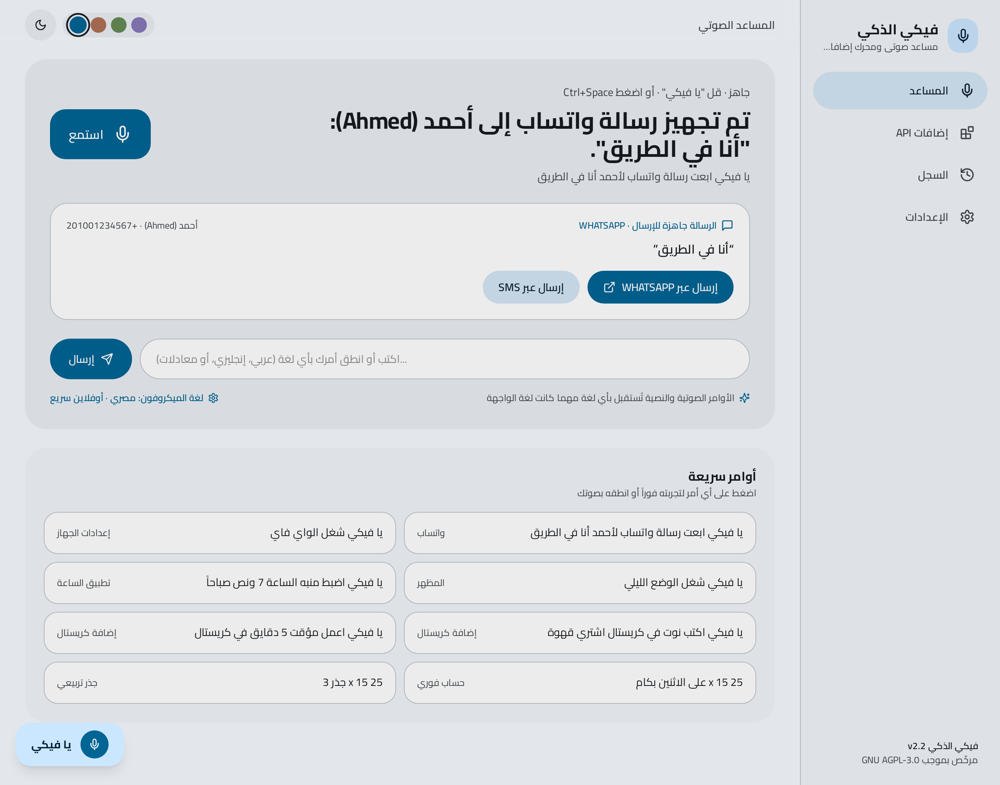
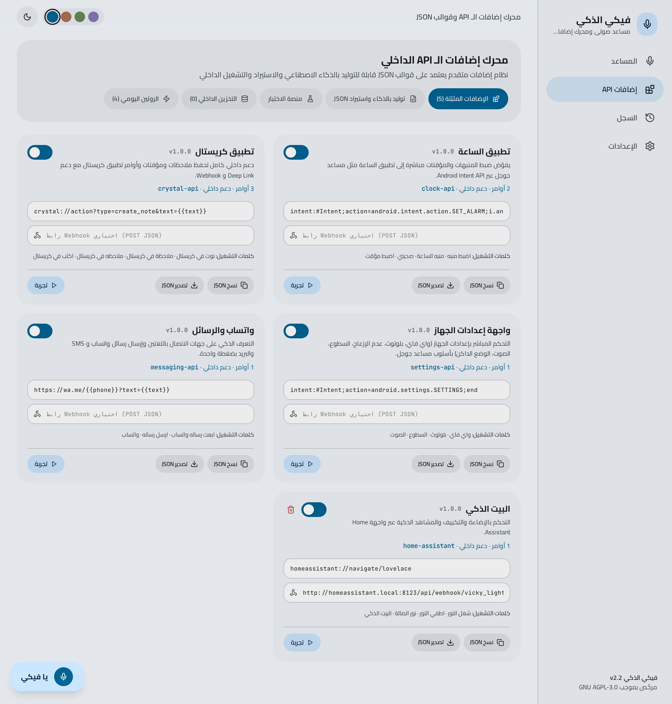
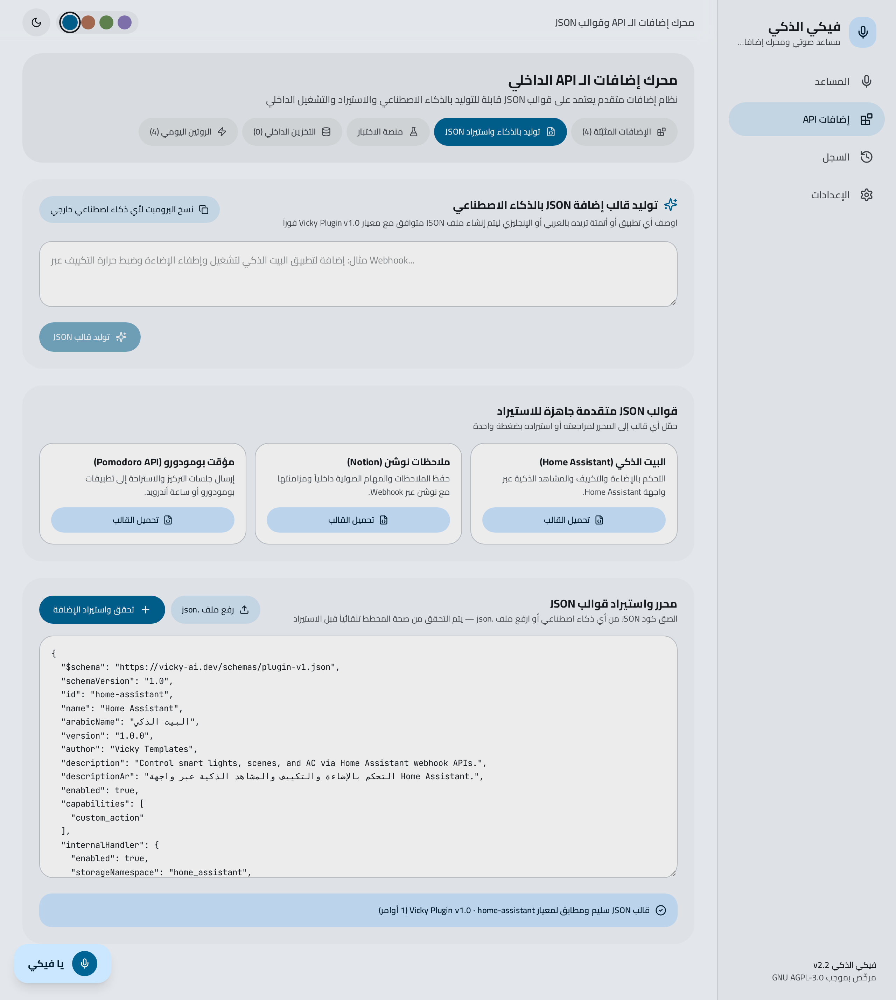
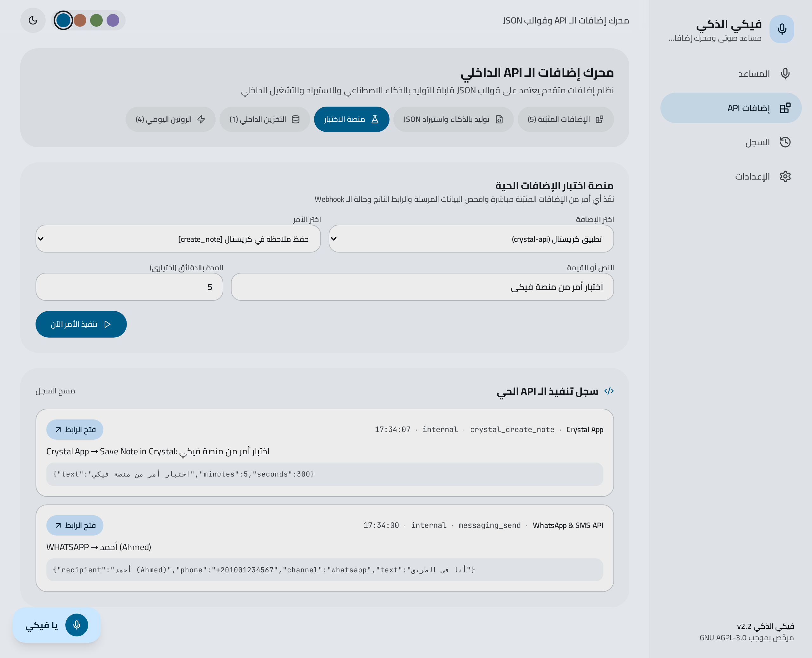
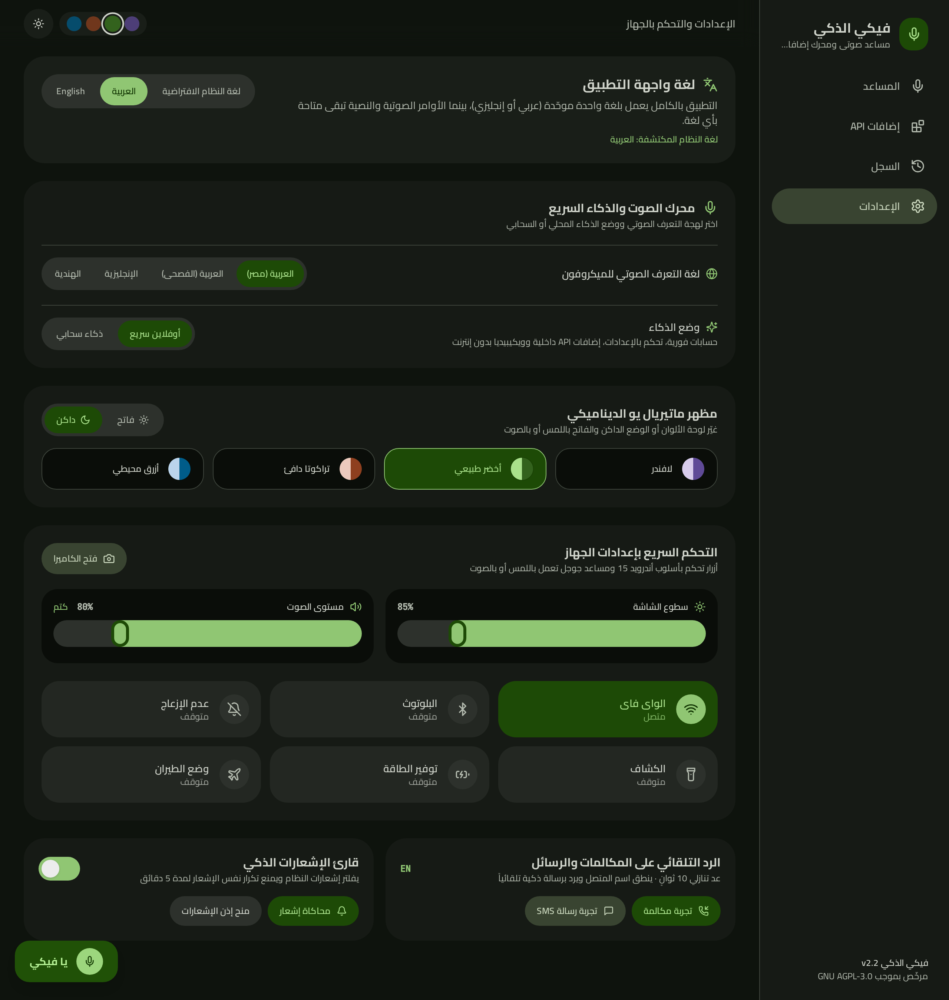

# فيكي الذكي (Vicky AI) — المساعد الصوتي ومحرك إضافات الـ API الداخلي

> 🌐 **اللغة:** [English](README.md) | **العربية**

[](./LICENSE)
[](./docs/DEVELOPER_API.ar.md)
[-386A20.svg)](#لقطات-حقيقية-من-التطبيق)

مساعد صوتي وأتمتة ذكية بأسلوب مساعد جوجل وتصميم **Material You (Material Design 3)**، يفتح تلقائياً بلغة النظام الافتراضية (**عربي RTL بالكامل** أو **إنجليزي LTR بالكامل**)، ويدعم استقبال الأوامر الصوتية والنصية بجميع اللغات، والتحكم الفوري بإعدادات الجهاز، مع **محرك إضافات JSON متقدم** قابل للتوليد بالذكاء الاصطناعي والاستيراد المباشر.



---

## المميزات الرئيسية

- **واجهة موحدة بلغة النظام الافتراضية**: يتعرف التطبيق تلقائياً على لغة نظام التشغيل أو المتصفح عند التشغيل (`dir="rtl"` للغة العربية أو `dir="ltr"` للإنجليزية)، مع إمكانية التبديل اليدوي من صفحة **الإعدادات** المستقلة. لا يوجد خلط بين اللغات داخل الواجهة — بينما تبقى **الأوامر الصوتية والنصية** مفتوحة لاستقبال العربية الفصحى والمصرية والإنجليزية والهندية في أي وقت.
- **ذكاء محلي فوري ومعالجة طبيعية للغة العربية**:
  - اكتشاف ذكي لكلمة التنبيه (`"يا فيكي"`, `"افيكي"`, `"Hey Vicky"`) مع نغمة استجابة ومنع التقاط صوت المساعد نفسه (TTS Echo Guard).
  - حاسبة فورية بدون إنترنت تفهم التعبيرات العربية المنطوقة مثل القسمة والضرب والنسب المئوية والجذور التربيعية (`25 x 15 على الاثنين بكام` أو `25 x 15 جذر 3` أو `احسب 25% من 480`)، بالإضافة إلى تحويل الوحدات، وملخصات ويكيبيديا، ووضع الذكاء السحابي الاختياري عبر `gemini-3.1-flash-lite`.
- **أسلوب مساعد جوجل وصفحة إعدادات مستقلة**:
  - يمرر أوامر المنبهات والمؤقتات مباشرة إلى تطبيق ساعة أندرويد (`SET_ALARM` / `SET_TIMER`) أو عبر الإضافات الخارجية مثل تطبيق كريستال بدون إزدحام الواجهة بمؤقت مدمج.
  - صفحة **إعدادات** مستقلة للتحكم بالواي فاي، البلوتوث، عدم الإزعاج، الكشاف، توفير الطاقة، وضع الطيران، السطوع، مستوى الصوت، ألوان **Material You** الديناميكية (لافندر، أخضر طبيعي، تراكوتا دافئ، أزرق محيطي)، الوضع الداكن/الفاتح، الرد التلقائي على المكالمات، وقارئ الإشعارات الذكي.
- **محرك إضافات JSON المتقدم (`Vicky Plugin Schema v1.0`)**:
  - توليد قوالب إضافات JSON صالحة مباشرة بالذكاء الاصطناعي (`POST /api/plugins/generate`) أو نسخ البرومبت الموحّد لاستخدامه مع أي نموذج ذكاء اصطناعي خارجي (ChatGPT، Claude، Gemini، Ollama).
  - رفع واستيراد ملفات `.json` مع فحص فوري للمخطط، وتصدير ملفات `.vicky.json`، واختبار الأوامر والروابط داخل **منصة الاختبار الحية**.
  - تنفيذ ثلاثي المسار: **التخزين الداخلي المعزول**، وروابط **Deep Link / Android Intent**، وطلبات **HTTP REST Webhook** — بالإضافة إلى `window.VickyAppBridge` و `window.AndroidBridge`.

---

## لقطات حقيقية من التطبيق

### الإضافات المثبتة وواجهات الـ API الداخلية
إدارة الإضافات المدمجة والمستوردة، تعديل قوالب الروابط العميقة وروابط الـ Webhook، التفعيل والتعطيل، وتصدير أو نسخ كود JSON بضغطة واحدة.



### توليد قوالب JSON بالذكاء الاصطناعي والاستيراد المباشر
اوصف أي تطبيق أو أتمتة منزلية بالعربي أو الإنجليزي لتوليد ملف JSON مطابق لمعيار Schema v1.0، أو حمّل أحد القوالب الجاهزة (البيت الذكي Home Assistant، ملاحظات نوشن Notion، مؤقت بومودورو)، أو ارفع ملف `.json` مع تحقق فوري من صحة القالب.



### منصة الاختبار الحية وسجل تنفيذ الـ API
اختبر أي أمر من أي إضافة مثبّتة بقيم مخصصة وراقب حمولة الـ JSON والرابط الناتج وطريقة التنفيذ وحالة الـ Webhook مباشرة.



### صفحة الإعدادات المستقلة — الوضع الداكن وألوان Material You
واجهة إعدادات متكاملة للتحكم باللغة، لهجة الميكروفون، وضع الذكاء، لوحات ألوان Material You والوضع الداكن، وأزرار التحكم السريع بإعدادات الجهاز.



---

## أمثلة الأوامر الصوتية

يمكنك نطق أو كتابة الأوامر بالعربية (فصحى أو مصرية) أو الإنجليزية بغض النظر عن لغة الواجهة المختارة:

| التصنيف | مثال بالعربية | مثال بالإنجليزية |
| --- | --- | --- |
| **إعدادات الجهاز** | `يا فيكي شغل الواي فاي` | `Hey Vicky, turn on Wi-Fi` |
| **المظهر والوضع الليلي** | `يا فيكي شغل الوضع الليلي` | `Hey Vicky, turn on dark mode` |
| **تطبيق الساعة (أندرويد)** | `يا فيكي اضبط منبه الساعة 7 ونص صباحاً` | `Hey Vicky, set alarm for 7:30 AM` |
| **رسائل واتساب و SMS** | `يا فيكي ابعت رسالة واتساب لأحمد أنا في الطريق` | `Hey Vicky, send WhatsApp to Ahmed saying on my way` |
| **إضافة تطبيق كريستال** | `يا فيكي اكتب نوت في كريستال اشتري قهوة` | `Hey Vicky, add note in Crystal buy coffee` |
| **الحسابات الفورية أوفلاين** | `يا فيكي 25 x 15 على الاثنين بكام` | `Hey Vicky, what is 25 x 15 / 2?` |
| **إضافة JSON مخصصة** | `يا فيكي شغل نور الصالة` | `Hey Vicky, living room light on` |
| **الروتين اليومي** | `يا فيكي صباح الخير` | `Hey Vicky, good morning` |

---

## توثيق المطورين وواجهة الإضافات (API)

التوثيق التقني الكامل لإنشاء وتوليد واستيراد الإضافات وربط تطبيقات أندرويد متوفر باللغتين:

- 📗 **[دليل المطورين وواجهة الإضافات والـ API (العربية)](docs/DEVELOPER_API.ar.md)** — شرح معمارية المحرك، جداول مخطط Schema v1.0، المتغيرات الديناميكية، البرومبت الموحّد لتوليد القوالب بالذكاء الاصطناعي، حزمة `window.VickyAppBridge`، وتكامل Android `<intent-filter>` و WebView و Webhooks.
- 📘 **[Developer & Plugin API Reference (English)](docs/DEVELOPER_API.md)** — Full English technical reference for developers.
- 🧩 **[ملف مثال جاهز للاستيراد (`docs/PLUGIN_SCHEMA_EXAMPLE.json`)](docs/PLUGIN_SCHEMA_EXAMPLE.json)** — قالب JSON متكامل لإضافة البيت الذكي (Home Assistant) قابل للرفع والتجربة فوراً داخل التطبيق.

---

## التشغيل والتطوير المحلي

### المتطلبات
- Node.js إصدار 20 أو أحدث
- npm إصدار 10 أو أحدث

### التثبيت والتشغيل

```bash
# 1. تثبيت الحزم
npm install

# 2. (اختياري) إعداد متغيرات البيئة لميزات الذكاء السحابي وتوليد القوالب
cp .env.example .env
# أضف GEMINI_API_KEY=... داخل ملف .env

# 3. تشغيل خادم Express و Vite على http://localhost:3000
npm run dev
```

### البناء وفحص الأنواع

```bash
npm run lint      # فحص TypeScript الصارم (tsc --noEmit)
npm run build     # بناء نسخة الإنتاج في مجلد dist/
npm start         # تشغيل خادم الإنتاج على المنفذ 3000
```

---

## الترخيص

تطبيق فيكي الذكي برمجية حرة مرخصة بموجب رخصة **GNU Affero General Public License v3.0 (`AGPL-3.0-only`)**. راجع ملف [`LICENSE`](./LICENSE) للتفاصيل الكاملة.
