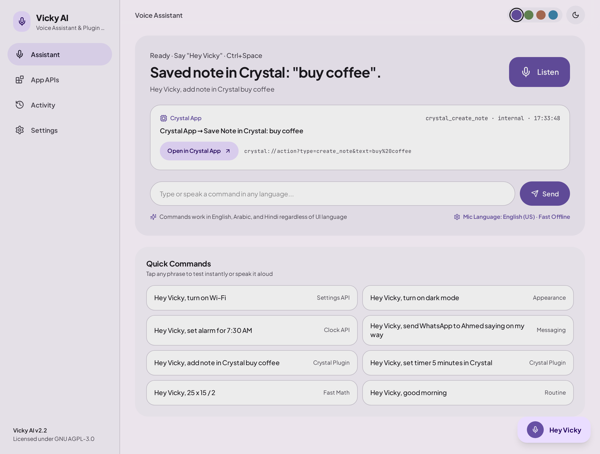
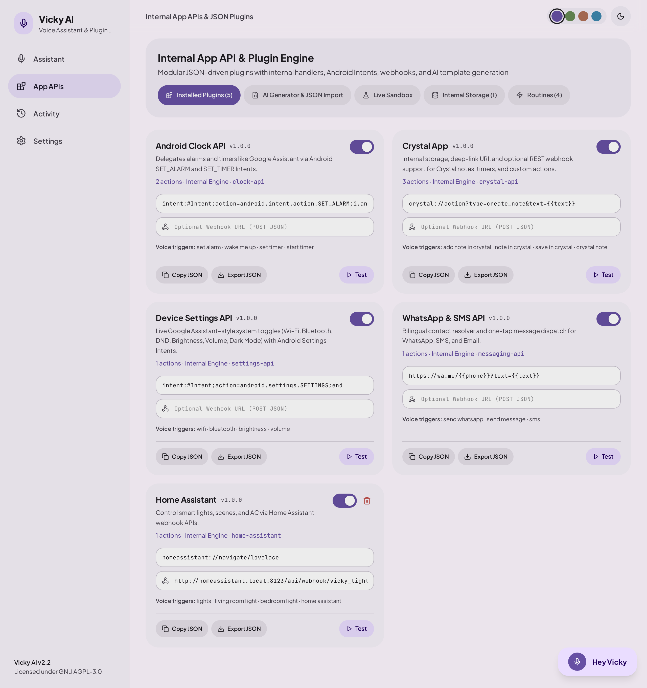
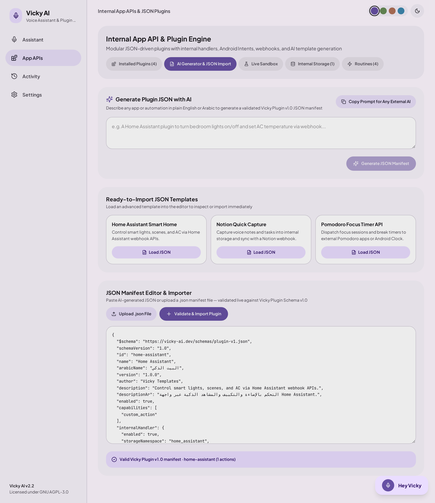
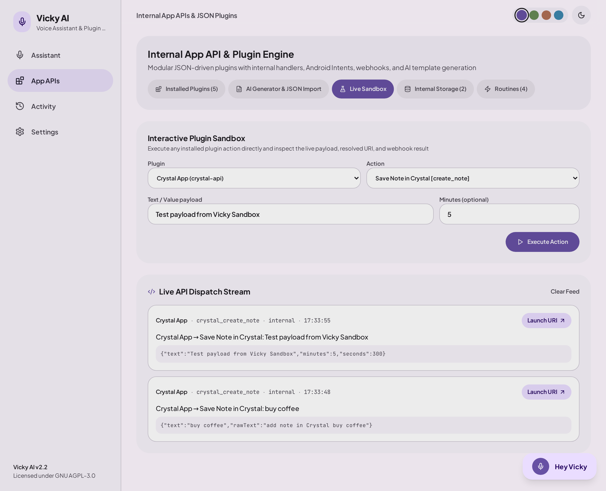
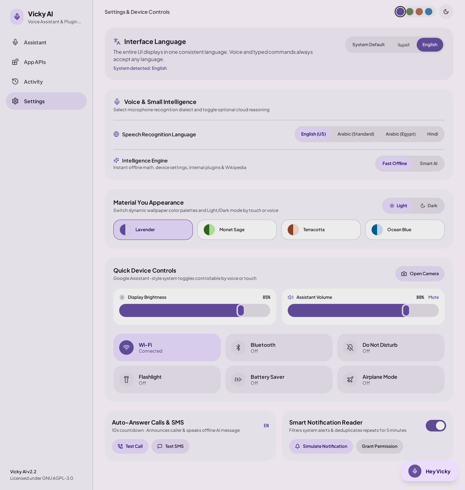

# Vicky AI — Voice Assistant & Internal Plugin Engine

> 🌐 **Language:** **English** | [العربية](README.ar.md)

[](./LICENSE)
[](./docs/DEVELOPER_API.md)
[-386A20.svg)](#screenshots)

A fast, Material You (Material Design 3) Google Assistant–style voice automation web application with **system-default pure English (LTR) / Arabic (RTL) localization**, multilingual voice & text command processing, live device controls, and an advanced **JSON-driven Internal App API & Plugin Engine**.



---

## Key Features

- **System-Default Pure UI Localization**: Automatically launches in **English (`dir="ltr"`)** or **Arabic (`dir="rtl"`)** matching your OS/browser language, with an instant override inside the standalone **Settings** page. The UI never mixes languages — while voice and typed commands always accept **English, Standard Arabic, Egyptian Arabic, and Hindi** simultaneously.
- **Fast Multilingual NLU & Small Intelligence**:
  - Fuzzy wake-word detection (`"Hey Vicky"`, `"يا فيكي"`, `"افيكي"`) with chime feedback and TTS self-echo protection.
  - Instant offline math parser supporting spoken English & Arabic expressions (including fractions, multiplication, percentages, and square roots such as `25 x 15 / 2` or `25 x 15 جذر 3`), unit conversions, bilingual Wikipedia summaries, and optional server-side `gemini-3.1-flash-lite` cloud reasoning.
- **Google Assistant–Style Delegation & Standalone Settings**:
  - Delegates alarms and timers cleanly to Android Clock Intents (`SET_ALARM`, `SET_TIMER`) or external plugins like Crystal App.
  - Dedicated **Settings** view for Wi-Fi, Bluetooth, Do Not Disturb, Flashlight, Battery Saver, Airplane Mode, Display Brightness, Volume, Material You Dynamic Color palettes (Lavender, Monet Sage, Terracotta, Ocean Blue), Light/Dark themes, Auto-Answer simulator, and Smart Notification Reader.
- **Advanced JSON Plugin Engine (`Vicky Plugin Schema v1.0`)**:
  - Generate validated JSON plugin manifests with AI (`POST /api/plugins/generate`) or copy the universal prompt for any external LLM (ChatGPT, Claude, Gemini, Ollama).
  - Drag/upload `.json` files, validate live against Schema v1.0, export `.vicky.json` manifests, inspect internal storage records, and test actions in the **Live Sandbox**.
  - Triple dispatch pipeline: **Internal Namespaced Storage**, **Deep Link / Android Intent URI**, and **HTTP REST Webhook** — plus `window.VickyAppBridge` and Android WebView `window.AndroidBridge`.

---

## Screenshots

### Internal App APIs & Installed Plugins
Manage built-in and user-imported JSON plugins, configure deep-link URI templates and REST webhooks, toggle availability, or export `.vicky.json` manifests in one click.



### AI Plugin Generator & JSON Manifest Importer
Describe any external app or smart-home workflow in plain English or Arabic to generate a validated Vicky Plugin v1.0 manifest, load starter templates (Home Assistant, Notion, Pomodoro), or import `.json` files with real-time schema validation.



### Live Plugin Sandbox & API Dispatch Stream
Test any installed plugin action with custom payloads and inspect the resolved deep-link URI, transport type, webhook HTTP status, and JSON dispatch stream in real time.



### Standalone Settings & Device Controls
Configure interface language, microphone dialect, offline/cloud intelligence mode, Material You dynamic color palettes, and Google Assistant–style quick device toggles.



---

## Voice Command Examples

Voice and text commands work in **any language**, regardless of whether the interface is set to English or Arabic:

| Category | English Example | Arabic Example |
| --- | --- | --- |
| **Device Settings** | `Hey Vicky, turn on Wi-Fi` | `يا فيكي شغل الواي فاي` |
| **Appearance** | `Hey Vicky, turn on dark mode` | `يا فيكي شغل الوضع الليلي` |
| **Android Clock API** | `Hey Vicky, set alarm for 7:30 AM` | `يا فيكي اضبط منبه الساعة 7 ونص صباحاً` |
| **WhatsApp & SMS** | `Hey Vicky, send WhatsApp to Ahmed saying on my way` | `يا فيكي ابعت رسالة واتساب لأحمد أنا في الطريق` |
| **Crystal App Plugin** | `Hey Vicky, add note in Crystal buy coffee` | `يا فيكي اكتب نوت في كريستال اشتري قهوة` |
| **Instant Offline Math** | `Hey Vicky, what is 25 x 15 / 2?` | `يا فيكي 25 x 15 على الاثنين بكام` |
| **Custom JSON Plugin** | `Hey Vicky, living room light on` | `يا فيكي شغل نور الصالة` |
| **Routines** | `Hey Vicky, good morning` | `يا فيكي صباح الخير` |

---

## Developer Documentation

Complete technical documentation for building, generating, importing, and integrating custom JSON plugins is available in both languages:

- 📘 **[Developer & Plugin API Reference (English)](docs/DEVELOPER_API.md)** — Full Schema v1.0 specification, template placeholders, AI generator endpoint & external LLM prompt, `window.VickyAppBridge` SDK, Android `<intent-filter>` XML, WebView `@JavascriptInterface`, and HTTP Webhook contract.
- 📗 **[دليل المطورين وواجهة الإضافات والـ API (العربية)](docs/DEVELOPER_API.ar.md)** — التوثيق التقني الكامل باللغة العربية مع لقطات شاشة حقيقية وأمثلة برمجية.
- 🧩 **[Ready-to-Import Example Manifest (`docs/PLUGIN_SCHEMA_EXAMPLE.json`)](docs/PLUGIN_SCHEMA_EXAMPLE.json)** — Complete Home Assistant JSON plugin ready to upload directly into Vicky AI.

---

## Getting Started

### Prerequisites
- Node.js 20+
- npm 10+

### Installation & Local Development

```bash
# 1. Install dependencies
npm install

# 2. (Optional) Configure environment variables for server-side Gemini features
cp .env.example .env
# Add GEMINI_API_KEY=... to .env for cloud Smart AI & AI JSON plugin generation

# 3. Start Express + Vite dev server on http://localhost:3000
npm run dev
```

### Build & Type-Check

```bash
npm run lint      # TypeScript strict type-check (tsc --noEmit)
npm run build     # Production Vite bundle -> dist/
npm start         # Run production Express server (port 3000)
```

---

## License

Vicky AI is free software licensed under the **GNU Affero General Public License v3.0 (`AGPL-3.0-only`)**. See [`LICENSE`](./LICENSE) for the full text.
