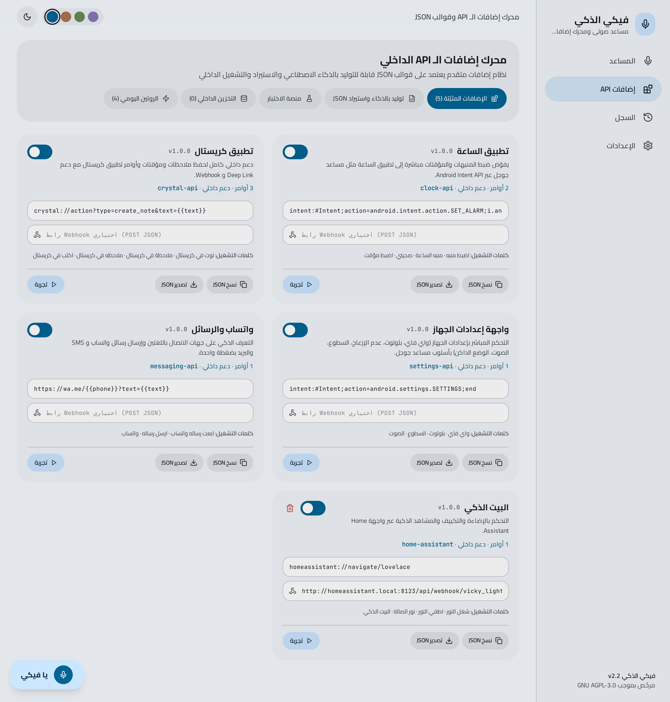
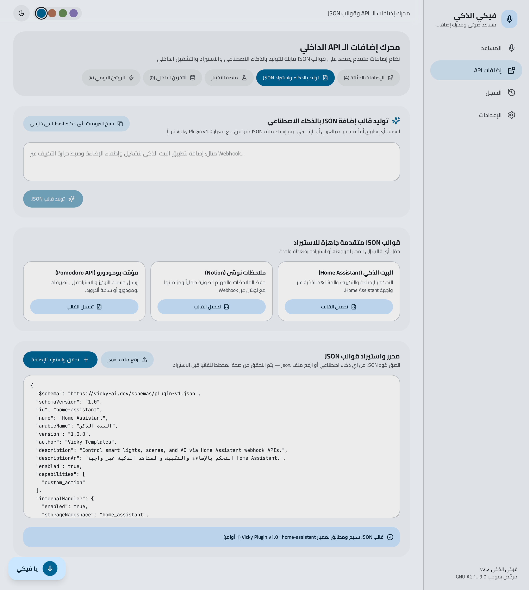
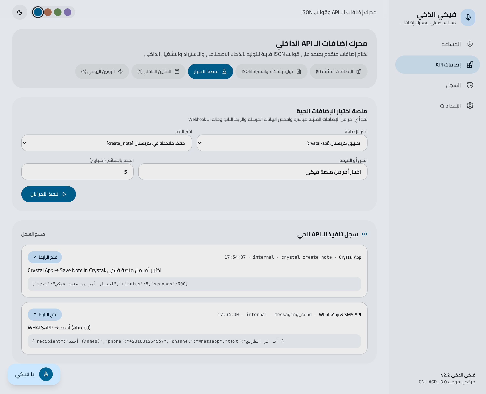

# فيكي الذكي (Vicky AI) — دليل المطورين وواجهة الإضافات والـ API

> 🌐 **اللغة:** [English](DEVELOPER_API.md) | **العربية** · [← العودة للصفحة الرئيسية](../README.ar.md)

**الترخيص:** GNU Affero General Public License v3.0 (`AGPL-3.0-only`)  
**إصدار مخطط الإضافات:** `1.0` (`https://vicky-ai.dev/schemas/plugin-v1.json`)

يوفّر **فيكي الذكي** محرك إضافات داخلي متقدم (**Internal App API & JSON Plugin Engine**) مصمم للمستخدمين والمطورين على حد سواء. يمكن تغليف أي تطبيق خارجي أو خادم بيت ذكي (Webhook) أو نشاط أندرويد (Android Intent) أو سير عمل داخلي داخل **ملف JSON قياسي** قابل للتوليد بالذكاء الاصطناعي، والتحقق الفوري، والتصدير بصيغة `.vicky.json`، والاستيراد المباشر داخل التطبيق.



---

## 1. النظرة المعمارية للمحرك

1. **واجهة موحدة بلغة النظام الافتراضية**: يكتشف التطبيق لغة النظام تلقائياً عبر `navigator.languages`. البيئات العربية تعمل بواجهة عربية 100% (`dir="rtl"` و `lang="ar"`)، وغيرها يعمل بواجهة إنجليزية 100% (`dir="ltr"` و `lang="en"`). ويمكن تغيير لغة الواجهة في أي وقت من صفحة **الإعدادات ← لغة واجهة التطبيق**.
2. **معالجة الأوامر الصوتية والنصية بجميع اللغات**: بغض النظر عن لغة الواجهة، يستقبل المساعد الأوامر الصوتية والنصية بالعربية الفصحى والمصرية والإنجليزية والهندية معاً في نفس الوقت.
3. **موجه الإضافات الديناميكي (JSON Plugin Router)**:
   - تُفحص إضافات JSON المخصصة المستوردة من المستخدم **أولاً** (تُعطى الأولوية لأطول عبارة تشغيل مطابقة بعد التطبيع اللغوي للعربية والإنجليزية).
   - تليها الإضافات المدمجة (`crystal-api`، `clock-api`، `settings-api`، `messaging-api`).
   - يتم استخراج المعاملات (`text`، `minutes`، `seconds`، `hour`، `minute`، `time24`، `value`، `phone`) تلقائياً من الكلام الطبيعي وحقنها داخل قوالب الروابط والـ Webhooks والردود الصوتية.
4. **مسار التنفيذ الثلاثي (Triple Execution Pipeline)**:
   - **المعالج الداخلي (Internal Handler)**: ينفذ الأمر محلياً داخل فيكي مع تخزين دائم معزول لكل إضافة (`InternalPluginRecord[]`).
   - **الروابط العميقة وأندرويد (Deep Link / Android Intent)**: يبني روابط مشفرة تلقائياً عبر `uriTemplate` مثل (`crystal://...` أو `intent:#Intent;...;end` أو `https://...`).
   - **طلبات HTTP REST Webhook**: يرسل اختيارياً طلبات `GET` أو `POST` أو `PUT` مع ترويسات مخصصة وحقن المتغيرات داخل `bodyTemplate`.
   - **بث الأحداث والجسر البرمجي**: يطلق حدث `window.dispatchEvent(new CustomEvent('vicky:app-action', { detail }))` ويستدعي `window.AndroidBridge?.onVickyAction(json)` عند العمل داخل Android WebView.

---

## 2. مواصفات مخطط إضافات فيكي (`Vicky Plugin Schema v1.0`)

راجع ملف المثال الكامل الجاهز للاستيراد مباشرة: [`PLUGIN_SCHEMA_EXAMPLE.json`](./PLUGIN_SCHEMA_EXAMPLE.json).

### الحقول الجذرية (Root Fields)

| الحقل | النوع | إلزامي؟ | الوصف |
| --- | --- | --- | --- |
| `$schema` | `string` | اختياري | رابط المخطط (`https://vicky-ai.dev/schemas/plugin-v1.json`). |
| `schemaVersion` | `"1.0"` | **نعم** | يجب أن تكون القيمة `"1.0"`. |
| `id` | `string` | **نعم** | معرّف نصي فريد يطابق النمط `^[a-z0-9][a-z0-9_-]{1,48}$`. |
| `name` | `string` | **نعم** | اسم الإضافة بالإنجليزية. |
| `arabicName` | `string` | مُوصى به | اسم الإضافة بالعربية (يظهر عند تفعيل الواجهة العربية). |
| `version` | `string` | مُوصى به | رقم الإصدار الدلالي (مثال: `"1.0.0"`). |
| `author` | `string` | اختياري | اسم المطور أو الجهة. |
| `description` | `string` | مُوصى به | وصف مختصر بالإنجليزية. |
| `descriptionAr` | `string` | اختياري | وصف مختصر بالعربية. |
| `enabled` | `boolean` | اختياري | القيمة الافتراضية `true`. |
| `capabilities` | `AppCapabilityKind[]` | اختياري | تُستنتج تلقائياً من `actions[]` إن لم تُحدد. القيم المسموحة: `create_note`، `set_timer`، `set_alarm`، `device_setting`، `send_message`، `custom_action`. |
| `internalHandler` | `object` | مُوصى به | `{ enabled: boolean, storageNamespace: string, storeRecords?: boolean, responseTemplateEn?: string, responseTemplateAr?: string }` |
| `actions` | `PluginActionDefinition[]` | **نعم** | مصفوفة غير فارغة من الأوامر الصوتية التي تنفذها الإضافة. |

### حقول الأوامر (`actions[]`)

| الحقل | النوع | إلزامي؟ | الوصف |
| --- | --- | --- | --- |
| `id` | `string` | **نعم** | معرّف الأمر الفريد داخل الإضافة. |
| `capability` | `AppCapabilityKind` | **نعم** | واحدة من القدرات الست المدعومة. |
| `title` / `titleAr` | `string` | مُوصى به | عنوان الأمر بالإنجليزية والعربية. |
| `triggers` | `{ en: string[], ar: string[] }` | **نعم** | عبارة تشغيل واحدة على الأقل (إنجليزية أو عربية). يتم تطبيع الحروف العربية تلقائياً (الهمزات، التاء المربوطة، التشكيل). |
| `parameters` | `PluginParameterDefinition[]` | اختياري | تعريف المعاملات المتوقعة (`name`، `type`، `required`، `source`، `defaultValue`). |
| `uriTemplate` | `string` | اختياري | قالب رابط Deep Link أو Android Intent. يتم ترميز القيم تلقائياً (URL Encoding). |
| `webhook` | `PluginWebhookConfig` | اختياري | `{ method: "POST" \| "GET" \| "PUT", url: string, headers?: Record<string,string>, bodyTemplate?: object }`. |
| `responseTemplateEn` | `string` | اختياري | قالب الرد الصوتي والنصي بالإنجليزية. |
| `responseTemplateAr` | `string` | اختياري | قالب الرد الصوتي والنصي بالعربية. |

### المتغيرات المدعومة داخل القوالب (Placeholders)

يمكنك استخدام الصيغة `{{placeholder}}` داخل `uriTemplate` و `webhook.url` و `webhook.bodyTemplate` و `responseTemplateEn` و `responseTemplateAr`:

- `{{text}}` — النص المستخلص بعد إزالة كلمات التشغيل.
- `{{minutes}}` — المدة المستخرجة بالدقائق (مثال: `25`).
- `{{seconds}}` — المدة المستخرجة بالثواني (مثال: `1500`).
- `{{hour}}` — ساعة المنبه بنظام 24 ساعة (`0`–`23`).
- `{{minute}}` — دقيقة المنبه (`0`–`59`).
- `{{time24}}` — الوقت بصيغة `HH:MM` (مثال: `"07:30"`).
- `{{value}}` — قيمة رقمية أو نصية عامة للإعدادات.
- `{{capability}}` — نوع القدرة المنفّذة.
- `{{phone}}` — رقم هاتف جهة الاتصال (عند الإرسال).

---

## 3. توليد قوالب إضافات JSON بالذكاء الاصطناعي



### المولد المدمج داخل التطبيق (`POST /api/plugins/generate`)
افتح **إضافات API ← توليد بالذكاء واستيراد JSON**، ثم اكتب وصف التطبيق أو الأتمتة التي تريدها بالعربي أو الإنجليزي واضغط **توليد قالب JSON**.
- نقطة النهاية على الخادم: `POST /api/plugins/generate` بحمولة `{ "prompt": "..." }` عبر نموذج `gemini-3.1-flash-lite` مع فرض مخطط JSON صارم.
- في حال عدم ضبط `GEMINI_API_KEY`، يقوم فيكي تلقائياً ببناء قالب محلي سليم وجاهز للتعديل والاستيراد الفوري.

### البرومبت الموحّد لأي ذكاء اصطناعي خارجي (ChatGPT / Claude / Gemini / Ollama)
انسخ النص التالي وضعه في أي نموذج ذكاء اصطناعي، ثم اكتب فكرة الإضافة في نهايته والصق الـ JSON الناتج مباشرة في **محرر واستيراد قوالب JSON**:

```text
Generate ONLY a valid JSON object conforming strictly to Vicky Plugin Schema v1.0 (no markdown fences, no commentary).

Schema Rules:
- "schemaVersion": "1.0"
- "id": lowercase slug (2-48 chars, e.g. "my-notes-app")
- "name": English app name
- "arabicName": Arabic app name
- "version": "1.0.0"
- "description": concise English description
- "descriptionAr": concise Arabic description
- "enabled": true
- "capabilities": array using ONLY: "create_note" | "set_timer" | "set_alarm" | "device_setting" | "send_message" | "custom_action"
- "internalHandler": { "enabled": true, "storageNamespace": "<slug>", "storeRecords": true }
- "actions": non-empty array of:
  {
    "id": "action_slug",
    "capability": "create_note" | "set_timer" | "set_alarm" | "custom_action",
    "title": "Action Title",
    "titleAr": "اسم الأمر",
    "triggers": { "en": ["english phrase"], "ar": ["عبارة عربية"] },
    "parameters": [{ "name": "text", "type": "string", "required": true, "source": "remainder" }],
    "uriTemplate": "app://action?text={{text}}&minutes={{minutes}}",
    "webhook": { "method": "POST", "url": "", "headers": { "Content-Type": "application/json" }, "bodyTemplate": { "text": "{{text}}" } },
    "responseTemplateEn": "Done: {{text}}",
    "responseTemplateAr": "تم التنفيذ: {{text}}"
  }

Available template placeholders: {{text}}, {{minutes}}, {{seconds}}, {{hour}}, {{minute}}, {{time24}}, {{value}}, {{capability}}, {{phone}}.
```

---

## 4. منصة الاختبار الحية وحزمة التطوير (`window.VickyAppBridge`)

استخدم تبويب **إضافات API ← منصة الاختبار** لتنفيذ أوامر تجريبية على أي إضافة وفحص الرابط الناتج وحمولة JSON وحالة الـ Webhook مباشرة:



كما يوفر فيكي واجهة برمجية جاهزة على `window.VickyAppBridge`:

```ts
interface VickyAppBridgeAPI {
  version: string; // "2.2.0"
  schemaVersion: '1.0';
  listPlugins: () => VickyAppManifest[];
  registerPlugin: (manifest: VickyAppManifest) => PluginValidationResult;
  unregisterPlugin: (pluginId: string) => boolean;
  dispatch: (
    appId: string,
    capability: AppCapabilityKind,
    payload: Record<string, unknown>,
    actionId?: string,
  ) => Promise<AppActionDispatch | null>;
  getRecords: (namespace?: string) => InternalPluginRecord[];
  onAction: (handler: (detail: AppActionDispatch) => void) => () => void;
}
```

### مثال استخدام برمجي

```js
// الاشتراك في سجل تنفيذ الأوامر الصوتية وأوامر منصة الاختبار
const stopListening = window.VickyAppBridge.onAction((dispatch) => {
  console.log('تم تنفيذ أمر:', dispatch.appId, dispatch.actionId, dispatch.payload);
});

// استدعاء إضافة تطبيق كريستال برمجياً لحفظ ملاحظة
await window.VickyAppBridge.dispatch(
  'crystal-api',
  'create_note',
  { text: 'مراجعة توثيق إضافات فيكي v1.0' },
  'crystal_create_note',
);
```

---

## 5. التكامل الأصلي مع تطبيقات أندرويد (Deep Links و WebView)

### 5.1 استقبال الروابط العميقة عبر `<intent-filter>`

سجّل الـ Scheme الخاص بتطبيقك داخل `AndroidManifest.xml` لاستقبال الروابط الناتجة من `uriTemplate`:

```xml
<activity android:name=".VickyActionActivity" android:exported="true">
  <intent-filter>
    <action android:name="android.intent.action.VIEW" />
    <category android:name="android.intent.category.DEFAULT" />
    <category android:name="android.intent.category.BROWSABLE" />
    <data android:scheme="crystal" android:host="action" />
  </intent-filter>
</activity>
```

### 5.2 ربط WebView عبر `@JavascriptInterface` (Kotlin)

عند تشغيل فيكي الذكي داخل Android WebView، أضف الجسر التالي لتنفيذ Android Intents مباشرة من التطبيق:

```kotlin
class VickyAndroidBridge(private val context: Context) {
    @JavascriptInterface
    fun onVickyAction(payloadJson: String) {
        val json = JSONObject(payloadJson)
        val uri = json.optString("uri")
        if (uri.isNotEmpty()) {
            val intent = Intent.parseUri(uri, Intent.URI_INTENT_SCHEME)
            context.startActivity(intent)
        }
    }
}

webView.settings.javaScriptEnabled = true
webView.addJavascriptInterface(VickyAndroidBridge(this), "AndroidBridge")
```

---

## 6. بروتوكول HTTP REST Webhook

عند تعيين `action.webhook.url` داخل ملف الإضافة:
- تكون طريقة الإرسال الافتراضية `POST` (مع دعم `GET` و `POST` و `PUT`).
- في حال وجود `bodyTemplate` يتم حقن جميع المتغيرات داخل كل الحقول النصية تلقائياً.
- في حال عدم تحديد `bodyTemplate` يرسل فيكي الحمولة القياسية التالية:

```json
{
  "source": "vicky-ai",
  "schemaVersion": "1.0",
  "appId": "home-assistant",
  "actionId": "toggle_lights",
  "capability": "custom_action",
  "payload": {
    "text": "نور الصالة",
    "rawText": "يا فيكي شغل نور الصالة"
  },
  "timestamp": "2026-05-01T12:30:00.000Z"
}
```
