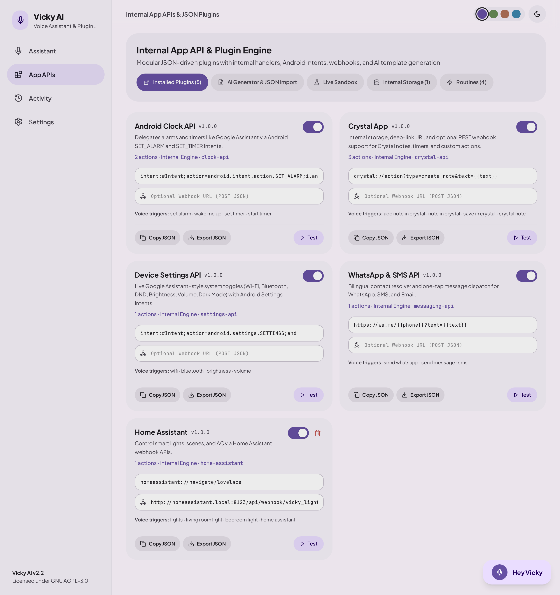
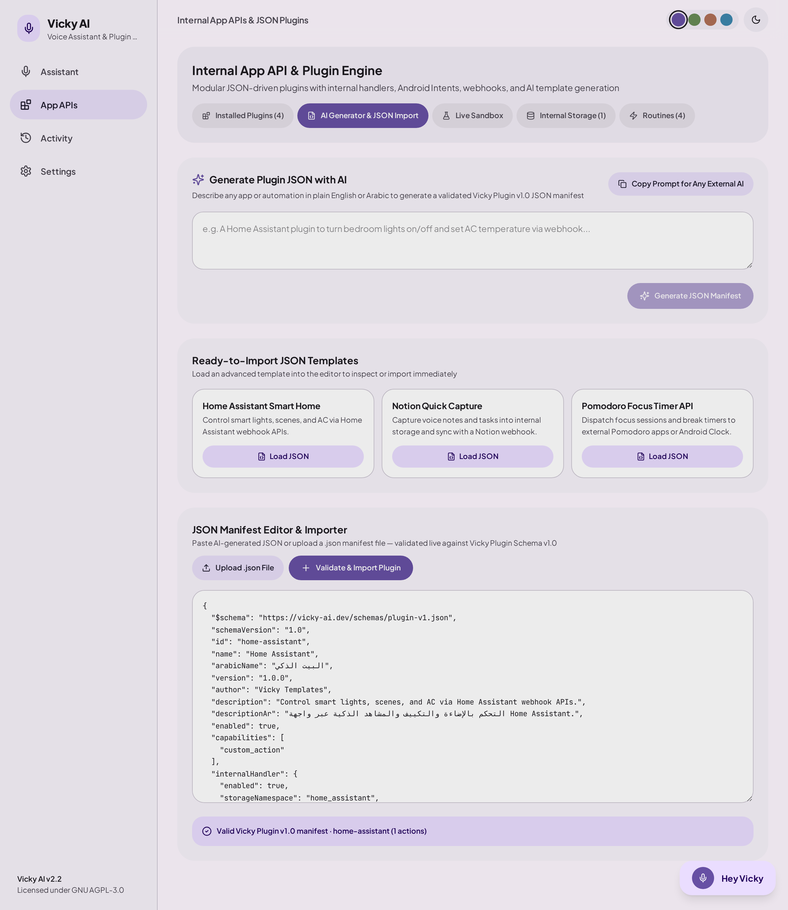
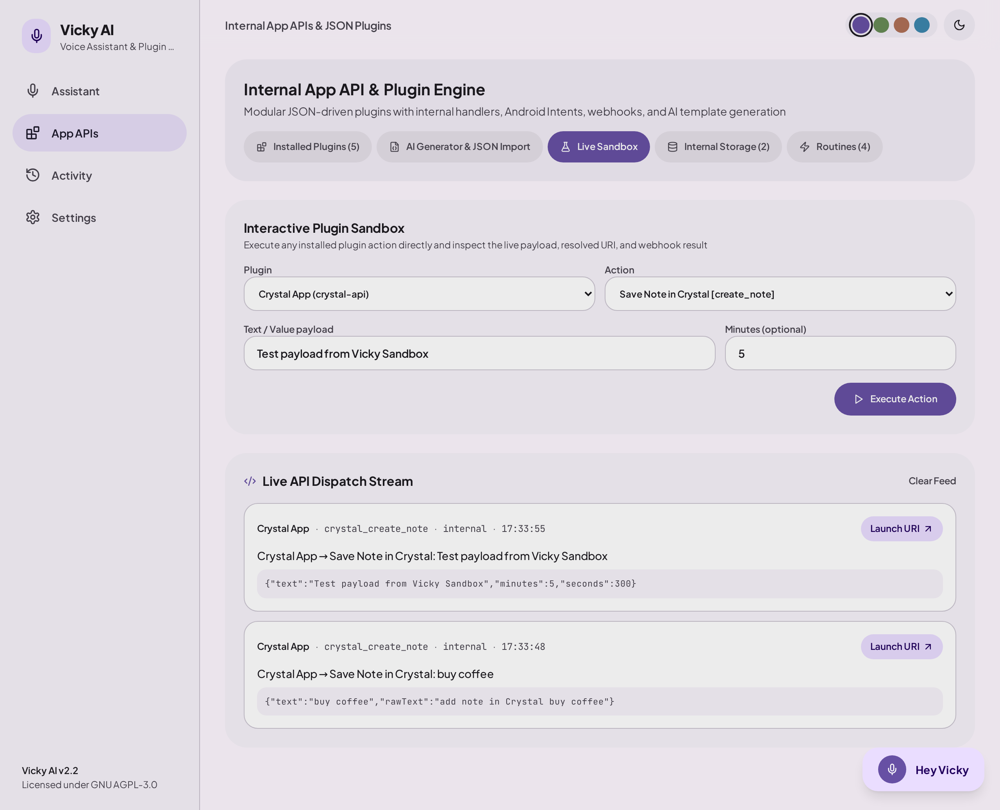

# Vicky AI — Developer & Plugin API Reference

> 🌐 **Language:** **English** | [العربية](DEVELOPER_API.ar.md) · [← Back to README](../README.md)

**License:** GNU Affero General Public License v3.0 (`AGPL-3.0-only`)  
**Plugin Schema Version:** `1.0` (`https://vicky-ai.dev/schemas/plugin-v1.json`)

Vicky AI provides an advanced, modular **Internal App API & JSON Plugin Engine** designed for both end-users and developers. Any external app, smart-home webhook, Android Activity, or internal productivity workflow can be packaged as a portable JSON manifest, generated via AI, validated live, exported as `.vicky.json`, and imported directly into Vicky AI.



---

## 1. Architecture Overview

1. **System-Default Pure UI Localization**: On launch, Vicky inspects `navigator.languages`. Arabic locales render in 100% Arabic (`dir="rtl"`, `lang="ar"`); all other locales render in 100% English (`dir="ltr"`, `lang="en"`). Users can override the interface language anytime inside **Settings -> Interface Language**.
2. **Multilingual Voice & Text Command Processing**: Regardless of the active UI language, voice and typed commands always accept English, Arabic (Standard & Egyptian), and Hindi simultaneously.
3. **Dynamic JSON Plugin Router**:
   - User-imported custom JSON plugins are matched **first** (longest normalized English or Arabic trigger phrase wins).
   - Built-in plugins (`crystal-api`, `clock-api`, `settings-api`, `messaging-api`) follow.
   - Parameters (`text`, `minutes`, `seconds`, `hour`, `minute`, `time24`, `value`, `phone`) are automatically extracted from natural speech and interpolated into URI templates, webhook payloads, and spoken bilingual responses.
4. **Triple Execution Pipeline**:
   - **Internal Handler**: Executes locally inside Vicky AI with persistent namespaced storage (`InternalPluginRecord[]`).
   - **Deep Link / Android Intent**: Builds RFC-encoded `uriTemplate` links (`crystal://...`, `intent:#Intent;...;end`, `https://...`).
   - **HTTP REST Webhook**: Optionally sends `GET`, `POST`, or `PUT` requests with custom headers and interpolated JSON `bodyTemplate`.
   - **Live Event & Bridge Broadcast**: Dispatches `window.dispatchEvent(new CustomEvent('vicky:app-action', { detail }))` and invokes `window.AndroidBridge?.onVickyAction(json)`.

---

## 2. Vicky Plugin Schema v1.0 Specification

See [`PLUGIN_SCHEMA_EXAMPLE.json`](./PLUGIN_SCHEMA_EXAMPLE.json) for a complete ready-to-import Home Assistant plugin manifest.

### Root Fields

| Field | Type | Required | Description |
| --- | --- | --- | --- |
| `$schema` | `string` | Optional | Schema URI (`https://vicky-ai.dev/schemas/plugin-v1.json`). |
| `schemaVersion` | `"1.0"` | **Yes** | Must be `"1.0"`. |
| `id` | `string` | **Yes** | Unique slug matching `^[a-z0-9][a-z0-9_-]{1,48}$`. |
| `name` | `string` | **Yes** | English display name. |
| `arabicName` | `string` | Recommended | Arabic display name rendered when the UI is in Arabic. |
| `version` | `string` | Recommended | Semantic version (e.g., `"1.0.0"`). |
| `author` | `string` | Optional | Author or organization name. |
| `description` | `string` | Recommended | Concise English description. |
| `descriptionAr` | `string` | Optional | Concise Arabic description. |
| `enabled` | `boolean` | Optional | Defaults to `true`. |
| `capabilities` | `AppCapabilityKind[]` | Optional | Auto-derived from `actions[]` if omitted. Allowed values: `create_note`, `set_timer`, `set_alarm`, `device_setting`, `send_message`, `custom_action`. |
| `internalHandler` | `object` | Recommended | `{ enabled: boolean, storageNamespace: string, storeRecords?: boolean, responseTemplateEn?: string, responseTemplateAr?: string }` |
| `actions` | `PluginActionDefinition[]` | **Yes** | Non-empty list of voice-triggered actions. |

### Action Fields (`actions[]`)

| Field | Type | Required | Description |
| --- | --- | --- | --- |
| `id` | `string` | **Yes** | Unique action identifier within the plugin. |
| `capability` | `AppCapabilityKind` | **Yes** | One of the 6 supported capabilities. |
| `title` / `titleAr` | `string` | Recommended | Human-readable action titles in English and Arabic. |
| `triggers` | `{ en: string[], ar: string[] }` | **Yes** | At least one English or Arabic voice trigger phrase. Arabic phrases are normalized automatically (alef/hamza/taa-marbuta/diacritics). |
| `parameters` | `PluginParameterDefinition[]` | Optional | Declares expected parameters (`name`, `type`, `required`, `source`, `defaultValue`). |
| `uriTemplate` | `string` | Optional | Deep-link or Android Intent URI template. Placeholder values are URI-encoded automatically. |
| `webhook` | `PluginWebhookConfig` | Optional | `{ method: "POST" \| "GET" \| "PUT", url: string, headers?: Record<string,string>, bodyTemplate?: object }`. |
| `responseTemplateEn` | `string` | Optional | English TTS & visual reply template. |
| `responseTemplateAr` | `string` | Optional | Arabic TTS & visual reply template. |

### Supported Template Placeholders

Use `{{placeholder}}` inside `uriTemplate`, `webhook.url`, `webhook.bodyTemplate`, `responseTemplateEn`, and `responseTemplateAr`:

- `{{text}}` — Extracted command text after removing trigger words.
- `{{minutes}}` — Parsed duration in minutes (e.g., `25`).
- `{{seconds}}` — Parsed duration in seconds (e.g., `1500`).
- `{{hour}}` — Parsed 24-hour alarm hour (`0`–`23`).
- `{{minute}}` — Parsed alarm minute (`0`–`59`).
- `{{time24}}` — Parsed `HH:MM` time string (e.g., `"07:30"`).
- `{{value}}` — Generic setting or numeric value.
- `{{capability}}` — Action capability slug.
- `{{phone}}` — Contact phone number (when applicable).

---

## 3. Generating Plugin JSON Templates with AI



### In-App Generator (`POST /api/plugins/generate`)
Open **App APIs -> AI Generator & JSON Import**, describe your target app or automation in English or Arabic, and click **Generate JSON Manifest**.
- Endpoint: `POST /api/plugins/generate` with JSON body `{ "prompt": "..." }` backed by `gemini-3.1-flash-lite` and structured JSON schema enforcement.
- If `GEMINI_API_KEY` is not configured, Vicky synthesizes a valid local starter manifest that you can edit and import immediately.

### Universal Prompt for External AI Assistants
Copy this prompt into ChatGPT, Claude, Gemini, or Ollama, describe your app at the end, and import the output JSON inside **App APIs -> AI Generator & JSON Import**:

```text
Generate ONLY a valid JSON object conforming strictly to Vicky Plugin Schema v1.0 (no markdown fences, no commentary).

Schema Rules:
- "schemaVersion": "1.0"
- "id": lowercase slug (2-48 chars, e.g. "my-notes-app")
- "name": English app name
- "arabicName": Arabic app name
- "version": "1.0.0"
- "description": concise English description
- "descriptionAr": concise Arabic description
- "enabled": true
- "capabilities": array using ONLY: "create_note" | "set_timer" | "set_alarm" | "device_setting" | "send_message" | "custom_action"
- "internalHandler": { "enabled": true, "storageNamespace": "<slug>", "storeRecords": true }
- "actions": non-empty array of:
  {
    "id": "action_slug",
    "capability": "create_note" | "set_timer" | "set_alarm" | "custom_action",
    "title": "Action Title",
    "titleAr": "اسم الأمر",
    "triggers": { "en": ["english phrase"], "ar": ["عبارة عربية"] },
    "parameters": [{ "name": "text", "type": "string", "required": true, "source": "remainder" }],
    "uriTemplate": "app://action?text={{text}}&minutes={{minutes}}",
    "webhook": { "method": "POST", "url": "", "headers": { "Content-Type": "application/json" }, "bodyTemplate": { "text": "{{text}}" } },
    "responseTemplateEn": "Done: {{text}}",
    "responseTemplateAr": "تم التنفيذ: {{text}}"
  }

Available template placeholders: {{text}}, {{minutes}}, {{seconds}}, {{hour}}, {{minute}}, {{time24}}, {{value}}, {{capability}}, {{phone}}.
```

---

## 4. Live Sandbox & Runtime JavaScript SDK (`window.VickyAppBridge`)

Use **App APIs -> Live Sandbox** to dispatch test payloads and inspect resolved URIs, JSON bodies, and webhook results interactively:



Vicky also mounts a typed developer SDK on `window.VickyAppBridge`:

```ts
interface VickyAppBridgeAPI {
  version: string; // "2.2.0"
  schemaVersion: '1.0';
  listPlugins: () => VickyAppManifest[];
  registerPlugin: (manifest: VickyAppManifest) => PluginValidationResult;
  unregisterPlugin: (pluginId: string) => boolean;
  dispatch: (
    appId: string,
    capability: AppCapabilityKind,
    payload: Record<string, unknown>,
    actionId?: string,
  ) => Promise<AppActionDispatch | null>;
  getRecords: (namespace?: string) => InternalPluginRecord[];
  onAction: (handler: (detail: AppActionDispatch) => void) => () => void;
}
```

### Example Usage

```js
// Subscribe to live voice & sandbox dispatches
const stopListening = window.VickyAppBridge.onAction((dispatch) => {
  console.log('Action:', dispatch.appId, dispatch.actionId, dispatch.payload);
});

// Trigger Crystal Note API programmatically
await window.VickyAppBridge.dispatch(
  'crystal-api',
  'create_note',
  { text: 'Ship Vicky Plugin v1.0 docs' },
  'crystal_create_note',
);
```

---

## 5. Android Native Integration (Deep Links & WebView Bridge)

### 5.1 Android `<intent-filter>` (Custom App Scheme)

Register your custom URI scheme in `AndroidManifest.xml` to receive deep links launched from `uriTemplate`:

```xml
<activity android:name=".VickyActionActivity" android:exported="true">
  <intent-filter>
    <action android:name="android.intent.action.VIEW" />
    <category android:name="android.intent.category.DEFAULT" />
    <category android:name="android.intent.category.BROWSABLE" />
    <data android:scheme="crystal" android:host="action" />
  </intent-filter>
</activity>
```

### 5.2 Android WebView `@JavascriptInterface`

When embedding Vicky AI inside an Android WebView container, expose `AndroidBridge`:

```kotlin
class VickyAndroidBridge(private val context: Context) {
    @JavascriptInterface
    fun onVickyAction(payloadJson: String) {
        val json = JSONObject(payloadJson)
        val uri = json.optString("uri")
        if (uri.isNotEmpty()) {
            val intent = Intent.parseUri(uri, Intent.URI_INTENT_SCHEME)
            context.startActivity(intent)
        }
    }
}

webView.settings.javaScriptEnabled = true
webView.addJavascriptInterface(VickyAndroidBridge(this), "AndroidBridge")
```

---

## 6. HTTP REST Webhook Contract

If `action.webhook.url` is configured:
- Method defaults to `POST` (supports `GET`, `POST`, `PUT`).
- If `bodyTemplate` is provided, every string leaf is interpolated with template placeholders.
- Otherwise Vicky sends the standard envelope:

```json
{
  "source": "vicky-ai",
  "schemaVersion": "1.0",
  "appId": "home-assistant",
  "actionId": "toggle_lights",
  "capability": "custom_action",
  "payload": {
    "text": "living room",
    "rawText": "turn on living room light"
  },
  "timestamp": "2026-05-01T12:30:00.000Z"
}
```
